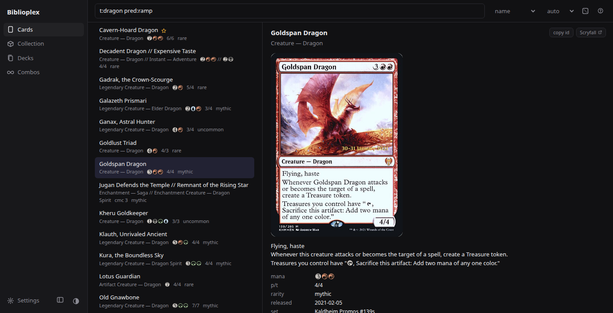
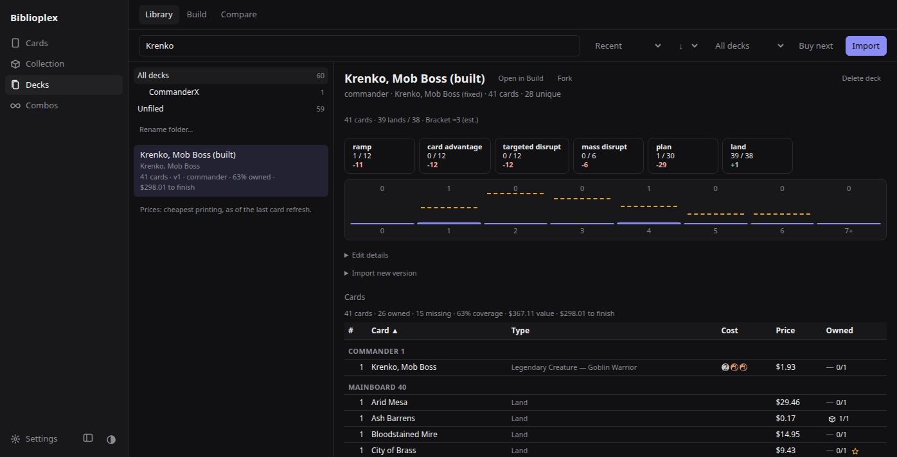
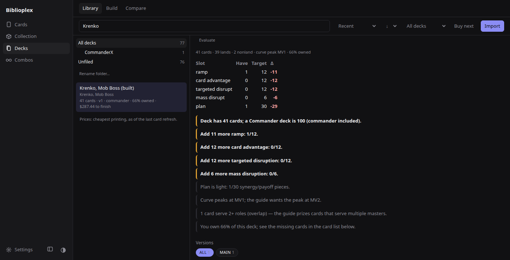
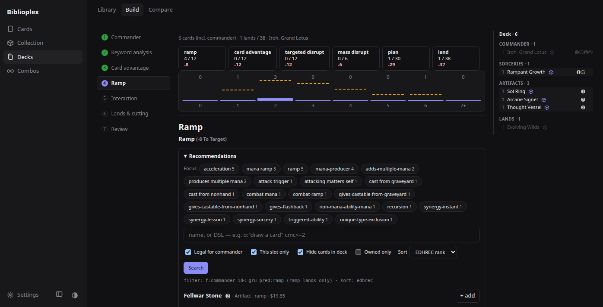
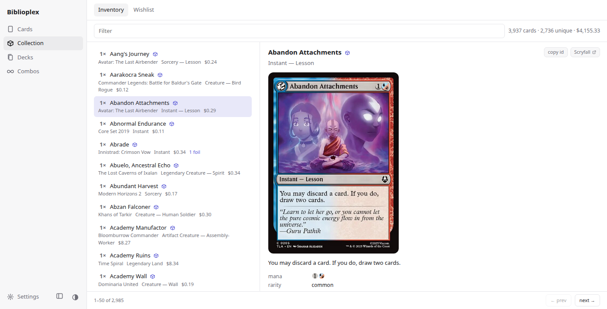
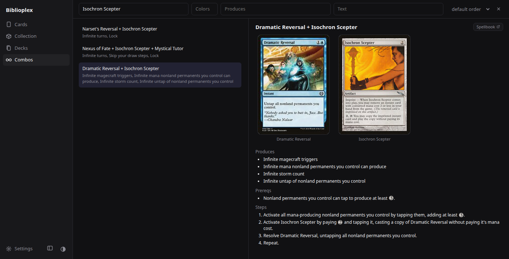

# Biblioplex

Your own Magic: The Gathering card database: search, collection, Commander deck building, and an MCP server so your AI can use it too. Self-hosted, CPU-only, Scryfall-compatible.

[](https://github.com/dgspai/biblioplex/actions/workflows/ci.yml)
[](LICENSE)




## Why this exists

I manage my collection in Deckbox, search cards on Scryfall, build decks in Archidekt and browse
other people's decks on Moxfield. Four good tools, four browser tabs, and none of them talks to the
others, or to an AI agent.

Biblioplex is my one place for all of it. It imports from those sites rather than replacing them,
keeps everything in a database I own, and exposes it over MCP, so I can ask my agent things like
"which of my decks can I finish for $50?" and get an answer grounded in my actual collection. Along
the way I added the features I wanted for myself: role labels for every card, a "what should I buy
next" planner, Commander bracket estimates and combo detection.

It is opinionated and built for one user: me, and maybe you, if your workflow looks like mine.

### What it isn't

- **Not a replacement for those sites.** No deck sharing, comments or community browsing; Moxfield and Archidekt do that well, and Biblioplex reads their exports.
- **Not multi-user.** One collection, one set of decks, no accounts.
- **Not a hosted service.** You run it; there is no public instance.
- **Not a price tracker.** Prices come from Scryfall's bulk data (cheapest printing, in USD) as of your last card refresh. No history, no alerts.

## Who it's for

- **For AI tinkerers:** an MCP server with 76 tools over search, your collection and your decks; vector similarity over oracle text (MiniLM embeddings in pgvector); and a rules classifier that labels cards by deckbuilding role (ramp, card advantage, targeted or mass disruption, plan), searchable with `pred:`.
- **For self-hosters:** one compose file, runs on CPU, and your collection and decks stay in your own Postgres. After the first sync, normal use makes no calls to Scryfall's API beyond three small catalog lookups at startup.
- **For players:** a web UI for your collection and wishlist, deck import from Moxfield, Archidekt and Deckbox, "what should I buy next", a Commander bracket estimate, and combos from Commander Spellbook.

## Features

**Search**
- Search about 34,600 unique cards with Scryfall syntax, plus `pred:`, `has:combo`, `combo:`, `edhrec<` and ownership operators.
- Find similar cards by embedding, or substitutes that keep a card's deck role.
- Inspect each card's oracle tags, related cards, combos and predicted role labels; see why a label applies and override it.
- Match names despite typos, with autocomplete and a random-card button.

**Collection**
- Import your inventory and wishlist from a Deckbox CSV, replacing or merging; set single-card quantities by hand.
- Track card counts, estimated value and import history, and re-download any past import.
- Filter any search by what you own (`in:inventory`, `owned:0`) or want (`is:wanted`).

**Decks**
- Import Moxfield, Archidekt and Deckbox exports (plain text, Arena, MTGO, CSV or the Deckbox print view); the format is detected from the content.
- Keep a version history per deck, with a branch per source, restore, fork and a pinnable head.
- Evaluate a deck against an EDH template (12 ramp, 12 card advantage, 12 targeted, 6 mass disruption, 30 plan, 38 lands) with a mana curve, improvement tips and a 1–5 bracket estimate. The bracket is a heuristic: 2 or more detected combos give bracket 5 even in casual decks ([details](docs/deck-bracket.md)).
- List the combos in a deck and the ones it is a card away from.
- Ask "what should I buy next?" across all your decks, with a budget and a card limit.
- Build a deck step by step in the Deck Building tab, from commander to lands.
- Analyse mana base, legality, upgrades, price, goldfish turns and opening hands; compare, diff and export lists for Arena or MTGO.

**AI and API**
- Expose the API as 76 MCP tools at `/mcp` (everything except the refresh trigger and the liveness probe), with optional bearer-token auth.
- Return Scryfall-shaped JSON: card bodies are Scryfall's own payload (plus role labels) and every error, including request-validation failures, uses Scryfall's envelope.
- Browse the live OpenAPI schema at `http://localhost:8000/docs`.

## Screenshots

| | |
|---|---|
|  |  |
| Deck scoreboard: slots, curve, bracket, combos | Evaluation against the EDH template |
|  |  |
| Deck Building, ramp step | Inventory (light theme) |
|  | |
| Combo browser | |

## Install

### From Docker Hub

```bash
mkdir biblioplex && cd biblioplex
curl -fsSLO https://raw.githubusercontent.com/dgspai/biblioplex/main/schema.sql
echo "DB_PASSWORD=$(openssl rand -hex 16)" > .env
```

Save this as `docker-compose.yml`:

```yaml
services:
  db:
    image: pgvector/pgvector:pg17
    environment:
      POSTGRES_DB: biblioplex
      POSTGRES_USER: biblioplex
      POSTGRES_PASSWORD: ${DB_PASSWORD}
    volumes:
      - pgdata:/var/lib/postgresql/data
      - ./schema.sql:/docker-entrypoint-initdb.d/schema.sql:ro
    healthcheck:
      test: ["CMD", "pg_isready", "-U", "biblioplex"]
      interval: 5s
  api:
    image: dgspai/biblioplex-api:latest
    environment:
      DATABASE_URL: postgresql+psycopg://biblioplex:${DB_PASSWORD}@db:5432/biblioplex
      SEARCH_DEFAULT_FILTER: game:paper f:commander
      MCP_AUTH_TOKEN: ${MCP_AUTH_TOKEN:-}
      HF_HOME: /models
    volumes:
      - hfcache:/models
    ports: ["${BIND_ADDR:-127.0.0.1}:8000:8000"]
    depends_on:
      db: { condition: service_healthy }
  web:
    image: dgspai/biblioplex-web:latest
    environment:
      DEFAULT_Q: game:paper f:commander
    ports: ["${BIND_ADDR:-127.0.0.1}:8080:80"]
    depends_on:
      - api
volumes:
  pgdata:
  hfcache:
```

```bash
docker compose up -d
# open http://localhost:8080
```

To pin a release, replace `latest` with a version such as `0.3.0` and fetch `schema.sql` from the matching tag (`.../biblioplex/v0.3.0/schema.sql`). To update, run `docker compose pull && docker compose up -d`. Every other setting is in [docs/configuration.md](docs/configuration.md).

### From source

```bash
git clone https://github.com/dgspai/biblioplex && cd biblioplex
cp .env.example .env          # set DB_PASSWORD
docker compose up -d --build
# open http://localhost:8080
```

### First boot

On a Ryzen 9 3900XT (12 cores, measured 2026-10-03) the first boot took about 5.5 minutes from `docker compose up --build` to a searchable instance: a little over 2 minutes to build the images and 3 minutes to download, embed and classify the cards. That run had the base images cached; a fresh machine also pulls about 0.5 GB of them. Combos keep importing in the background after that. A full Commander Spellbook pull takes about 1 h 20 min (documented, not measured here), and combos become searchable as they arrive. While cards load, the UI re-runs your search once cards are ready, and a banner shows "N of M steps" until cards are searchable; combos keep importing, with progress in **Settings → Card data** and on `http://localhost:8000/health`. An interrupted combo import (a restart mid-pull) doesn't resume: re-run it from **Settings → Card data → Advanced: choose which steps to run**, ticking only **Combos**.

## How to use

1. **Cards**: search with [Scryfall syntax](docs/search-syntax.md) and open a card for its details, roles, similar cards and combos.
2. **Settings → Import from Deckbox**: upload your inventory and wishlist CSVs.
3. **Decks → Import**: upload or paste a Moxfield, Archidekt or Deckbox export. Open a deck for its evaluation, bracket, combos and cost to finish; **Buy next** plans purchases across all decks.
4. **Decks → Build**: build a Commander deck step by step, from commander to lands.
5. **Combos**: browse Commander Spellbook combos by card, colour or result.

Every tab is described in [docs/web-ui.md](docs/web-ui.md). To use it from an AI agent, see below.

## Use it from Claude or any MCP client

With the stack running, add the server to Claude Code:

```bash
claude mcp add --transport http biblioplex http://localhost:8000/mcp
```

Other clients take the same URL as a streamable-HTTP server. **20 of the 76 tools write data** (decks, collection, wishlist), so set `MCP_AUTH_TOKEN` in `.env` (`openssl rand -hex 32`) and pass `--header "Authorization: Bearer $MCP_AUTH_TOKEN"` whenever anything but you can reach the API. Then try:

- "Which Commander-legal red-green ramp creatures do I already own, and which is most played?"
- "Evaluate my <deck name> deck: bracket, combos in it, combos one card away, and what to add for card advantage."
- "I have $50. Which of my decks can I finish first, and what do I need to buy? Skip cards already on my wishlist."

The tool list is large (about 86 KB, roughly 20k tokens of client context). If your client supports tool annotations, write tools are flagged. The full tool table, JSON client config and auth details are in [docs/mcp.md](docs/mcp.md).

## Search syntax at a glance

```text
t:dragon pred:ramp                    # dragons that ramp
pred:card_advantage c:u cmc<=2        # cheap blue card advantage
otag:removal c:r usd<1                # red removal under $1
has:combo t:artifact                  # artifacts in a known combo
combo:"Isochron Scepter"              # cards that combo with Isochron Scepter
is:commander id<=esper edhrec<500     # popular Esper-or-narrower commanders
is:unowned is:wanted                  # your shopping list (after importing a wishlist)
otag:sweeper-one-sided id<=wb         # one-sided board wipes in Orzhov colours
```

Results are scoped by `SEARCH_DEFAULT_FILTER`, which `.env.example` sets to `game:paper f:commander`. Full reference and tested examples: [docs/search-syntax.md](docs/search-syntax.md).

## Requirements

Measured on a Ryzen 9 3900XT with 31 GiB RAM, Docker 29.8, 2026-10-03:

- **Docker** with Compose v2. Only amd64 has been tested.
- **RAM:** about 1.4 GiB peak for the whole stack during the first ingest (API 1.1 GiB), about 1.3 GiB steady. 2 GB free is a comfortable floor.
- **Disk:** about 9 GB: the API image is 6.6 GB (pip installs the CUDA build of PyTorch, though inference runs on CPU), the card database 1.7 GB, the embedding model 92 MB.
- **First boot:** about 5.5 minutes to searchable, as above.
- **Outbound HTTPS:** `api.scryfall.com` and the bulk-data files it links to (card data), `huggingface.co` (embedding model, only when it isn't cached, normally the first start), `json.commanderspellbook.com` (combos), and PyPI while building. Browsers load card images and mana symbols from Scryfall's CDN.

## Exposing it

Compose publishes ports 8000 (API) and 8080 (web) on `127.0.0.1` only. The REST API has no authentication, so before setting `BIND_ADDR=0.0.0.0` (in `.env`, then run `docker compose up -d` again to apply) or putting it behind a proxy, read [SECURITY.md](SECURITY.md).

## Documentation

- [Search syntax](docs/search-syntax.md): operators, Biblioplex extensions, tested queries
- [MCP server](docs/mcp.md): client setup, auth, all 76 tools, example prompts
- [HTTP API reference](docs/api.md): every endpoint with curl examples
- [Web UI](docs/web-ui.md): what each tab does
- [Configuration](docs/configuration.md): environment variables
- [Architecture notes](docs/architecture.md): ingest pipeline, data sources, similarity evaluation, limitations
- [Development](docs/development.md): local dev and the smoke test
- [EDH deckbuilding guide](docs/edh-guide.md) and [bracket estimate](docs/deck-bracket.md): the method behind the deck tools
- [Changelog](docs/changelog.md)

## Contributing

Bug reports and focused pull requests are welcome. See [CONTRIBUTING.md](CONTRIBUTING.md) for the dev setup and the gate (`make check`).

## Relationship to Magic sites

How Biblioplex uses each site. For trademarks and affiliation, see [Disclaimers](#disclaimers).

### Scryfall

**Data sourcing**
- No Scryfall data is redistributed in this repository.
- Card data is fetched at runtime from Scryfall's public bulk-data endpoint on first boot of your local instance, using an accurate `User-Agent` (`biblioplex/<version>`) and `Accept` header per Scryfall's guidelines.
- No images are re-hosted. Clients receive the original `image_uris` pointing at Scryfall's CDN, unmodified, with artist and copyright information intact.
- No live proxying. Once the local database is populated, card lookups and searches are served locally. The API calls `api.scryfall.com` only for three keyword catalogs (`/catalog/keyword-abilities`, `/catalog/keyword-actions`, `/catalog/ability-words`) each time it starts, and for the bulk-data index and the bulk files it links to when card data is refreshed.

**Value beyond the bulk data**
- Vector similarity search over oracle text (pgvector + SentenceTransformer embeddings)
- Rules-layer classification of cards into deckbuilding roles (ramp / card-advantage / disruption / removal / plan)
- Deckbuilding tooling grounded in [`docs/edh-guide.md`](docs/edh-guide.md): a guided Deck Building tab (web) and saved-deck evaluation (`GET /decks/:id/evaluate`), plus analyze / suggest / manabase / goldfish / bracket / legality / combo endpoints — all MCP-exposed
- Multi-face flattening into searchable columns plus reversible-card splitting into per-face rows
- Local-only operation designed to reduce automated load on Scryfall's API

**Restrictions on operators of a Biblioplex instance**
- Do not paywall or restrict access to Scryfall-sourced data behind your deployment.
- Do not present Scryfall data as belonging to any game other than Magic: The Gathering.
- Do not use the Scryfall name or logos in a way that implies endorsement of your deployment.
- Do not modify card images (crop, blur, watermark, etc.). Use of `art_crop` requires showing artist and copyright in the same interface.

Use of Scryfall's bulk data and API is subject to Scryfall's terms: <https://scryfall.com/docs/api>.

### Deckbox, Archidekt and Moxfield

These are where my collection and decks live. Biblioplex reads from them; it doesn't replace them.

- **Your own exports.** Inventory, wishlist and deck imports take files you export yourself (Deckbox CSV, plain text, Arena, MTGO, CSV, the Deckbox print view) or paste in.
- **The server doesn't scrape them.** The API makes no requests to Archidekt or Moxfield. An optional Deckbox URL sync (`/inventory/sync/deckbox`) fetches a public set export; Deckbox now requires a login for exports, so it is hidden in the UI.
- **Links back.** Saved decks can store a link to the same deck on each site, and the UI links out to them.

### EDHREC

- `edhrec_rank`, used for popularity sorting and filters such as `edhrec<500`, comes from Scryfall's bulk data. The running app never contacts [EDHREC](https://edhrec.com).
- [`data/reference_decks/`](data/reference_decks/) holds 10 EDHREC "average deck" lists, sample input for the template evaluation script (`scripts/eval_template.py`). The lists are EDHREC's work and are credited to them. They were collected once with `scripts/scrape_edhrec_decks.py` from EDHREC's JSON pages, which are undocumented and not a public API. If you re-run it, keep it occasional (the script waits 1 s between requests) and respect EDHREC's terms.

### Commander Spellbook

- Combo data comes from [Commander Spellbook](https://commanderspellbook.com)'s bulk file (`json.commanderspellbook.com/variants.json.gz`), which Spellbook publishes so clients don't page through its API. It is on by default.
- It is downloaded once per card-data refresh (about 32 MB) with Biblioplex's `User-Agent`. Turn it off with `COMBOS_SOURCE_URL=` (empty) in `.env`.
- Each combo in the UI links to its page on commanderspellbook.com.

## Disclaimers

Biblioplex is unofficial Fan Content permitted under the Fan Content Policy. Not approved/endorsed by Wizards. Portions of the materials used are property of Wizards of the Coast. ©Wizards of the Coast LLC.

- **Wizards of the Coast.** Card data, card images and mana symbols are © Wizards of the Coast LLC. Magic: The Gathering is a trademark of Wizards of the Coast LLC.
- **Scryfall.** Not affiliated with, endorsed by or sponsored by Scryfall, LLC. Scryfall is a trademark of Scryfall, LLC. Card data and images come from Scryfall under its [terms](https://scryfall.com/docs/api).
- **Deckbox.** Not affiliated with, endorsed by or sponsored by Deckbox or its operator, Leaping Frog Studios S.R.L. The name is used only to describe import compatibility.
- **Archidekt.** Not affiliated with, endorsed by or sponsored by Archidekt, Archidekt LLC or Space Cow Media. The name is used only to describe import compatibility.
- **Moxfield.** Not affiliated with, endorsed by or sponsored by Moxfield or Moxfield LLC. The name is used only to describe import compatibility.
- **EDHREC.** Not affiliated with, endorsed by or sponsored by EDHREC or Space Cow Media. The lists in [`data/reference_decks/`](data/reference_decks/) are EDHREC's work and are credited to them.
- **Commander Spellbook.** Not affiliated with, endorsed by or sponsored by Commander Spellbook, its Community Admins or Space Cow Media. Combo data is their work, taken from the public bulk file; as Spellbook asks, Biblioplex credits [commanderspellbook.com](https://commanderspellbook.com) and links each combo back to its page.

## License

MIT — see [`LICENSE`](LICENSE).
